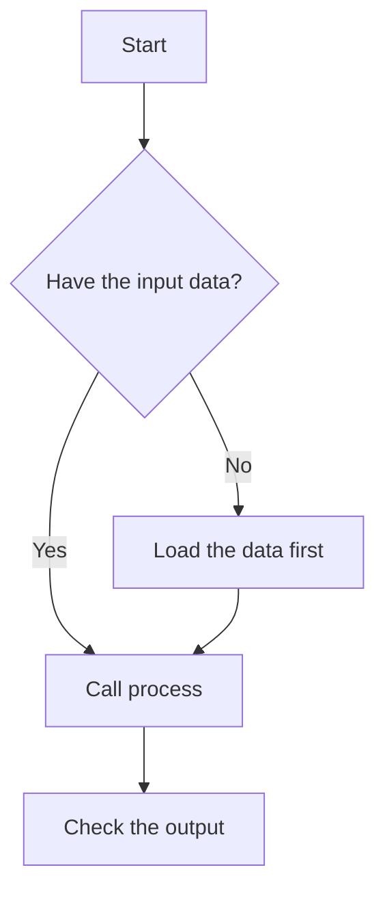

# Design docs

Covers the four doc types Gonçalo produces for frameworks: design docs, ADRs, READMEs, and non-technical usage guides. Quick scripts and POCs don't use these — see the `build-conventions` skill for their lightweight handling (POC READMEs stay inline and freehand, not templated).

Every doc below used to be written freehand with no fixed shape. That's the thing this skill replaces: pick the matching template, fill it in, don't improvise new sections or drop the ones that don't feel needed that day.

## Bilingual docs

Every doc type here gets produced in both languages, because any of them might end up in front of Portuguese stakeholders:

- Canonical English file: `<name>.md`. Portuguese twin: `<name>.pt.md`. E.g. `design-doc.md` + `design-doc.pt.md`, `README.md` + `README.pt.md`.
- The Portuguese version is a full translation, including section headings — not just the body text. Structure (which sections exist, in what order) stays identical between the two.
- Code identifiers, function names, and literal commands stay in English in both versions — only prose translates. This includes comments inside example code blocks: the comment text translates (Portuguese in `.pt.md`, English in `.md`), the code around it doesn't.
- If a doc gets revised after review feedback, update both files in the same pass. Don't let one drift ahead of the other.

## Where docs live

All of these live inside the framework's own repo, under a `docs/` folder at the root — except the README, which stays at the repo root as usual:

- `docs/design-docs/<slug>.md` + `.pt.md`
- `docs/adrs/<number>-<slug>.md` + `.pt.md`
- `docs/usage-guide.md` + `.pt.md` (or `docs/usage-guides/<slug>.md` if there's more than one, e.g. one per distinct user group)
- `README.md` + `README.pt.md` at the repo root

The README's Documentation section (below) points to whichever of these actually exist for a given project — don't link to a doc type that hasn't been written yet.

## Diagrams (Mermaid)

Use Mermaid for any flow, decision, or architecture visualization — it renders directly in markdown, no extra tooling needed.

- **Usage guide: mandatory.** Every usage guide includes a flowchart showing the operations a user can trigger and the choices/branches between them. This is the one non-negotiable diagram — it's what lets a non-technical reader navigate the tool confidently without reading code or asking Gonçalo.
- **Design doc: strongly encouraged**, in the Proposed design section, whenever there's a flow, sequence, or component relationship clearer as a picture than as prose — `flowchart` for process flow, `sequenceDiagram` for interactions between components, `classDiagram` for a data model.
- **ADR / README:** optional — only if a diagram clarifies something the prose genuinely doesn't (e.g. a before/after shape for an ADR's decision).
- Prefer `flowchart TD` (top-down) for operation/decision flows specifically — it reads most naturally for a non-technical reader scanning top to bottom.
- Diagram text translates with the rest of the doc: node labels in the English file are in English, node labels in the `.pt.md` twin are in Portuguese. The diagram's structure (nodes, edges, branches) stays identical between the two — only the labels change.

Example flowchart for a usage guide:



## Design doc

Audience: technical — Gonçalo and whoever else is reviewing/approving the approach before it gets built.

```markdown
# <Title>

**Status:** Draft / In review / Approved
**Author:**
**Date:**

## Problem
What's broken, missing, or costly enough to be worth solving right now.

## Goals
What this specifically needs to achieve.

## Non-goals
What's explicitly out of scope, so reviewers don't assume it's being solved here too.

## Proposed design
How it works. This is the bulk of the doc.

## Alternatives considered
Other approaches that were weighed, and why each was rejected.

## Open questions / risks
What's unresolved, and what could go wrong.
```

## ADR (architecture decision record)

Audience: technical. One decision per doc — lighter than a full design doc. Use when a single significant technical choice needs a durable record (e.g. "why Delta Lake over Parquet," "why Airflow over Fabric pipelines for this").

```markdown
# ADR-<number>: <decision>

**Status:** Proposed / Accepted / Superseded by ADR-<n>
**Date:**

## Context
The situation that forced a decision to be made.

## Decision
What was decided, stated directly — not "we are leaning towards," state it.

## Consequences
What this makes easier, what it makes harder, and what tradeoffs were accepted.
```

## README

Audience: technical — whoever picks up the repo, including Gonçalo in six months. This is the README that `build-conventions` says every framework needs before adding features; this skill supplies its actual shape.

```markdown
# <Project name>

<One-line description of what this is.>

## Setup
Venv creation, dependency install, any config/`.env` the project needs before it'll run.

## Usage
How to run it / import it, with a minimal real example.

## Project structure
What each top-level folder/module is for — map it to the package's actual layout.

## Documentation
Where to find the other docs — design doc(s), ADRs, usage guide(s) — linking to whichever actually exist under `docs/` (see "Where docs live" above). Don't list a doc type that wasn't written for this project.
```

## Usage guide (non-technical)

Audience: the non-technical clients/colleagues the facade pattern is built for. Assume zero coding knowledge — not "a bit rusty," actually zero. No jargon, no internals, no mention of classes or modules — written as if the facade's public functions are the entire product, because to this reader they are.

```markdown
# <Tool name> — guia de utilização

## O que isto faz
O que a ferramenta resolve, em linguagem simples — o resultado, não a implementação.

## Fluxo
Um diagrama Mermaid (`flowchart TD`) com as operações disponíveis e as escolhas entre elas — a visão geral antes do passo a passo.

## Como usar
Uma entrada por função do facade que o utilizador vai precisar de chamar. Para cada uma:

- **O que faz.** Se o docstring da função for curto e suficientemente descritivo, parte dele — mas reescreve em linguagem simples, sem jargão técnico.
- **Cada argumento, explicado duas vezes.** Primeiro o que aquele argumento significa dentro da função (ex: "a data a partir da qual procurar registos"). Depois, quando fizer sentido, o que aquele argumento representa no contexto mais amplo do trabalho do utilizador (ex: "normalmente, a data em que a equipa fez o último fecho de contas").
- **O que esperar como resultado.**

## Exemplos
Pelo menos um exemplo completo, com inputs e outputs reais, com um comentário em cada chamada de função e em cada argumento (ver estilo de exemplo abaixo).

## Problemas comuns
Erros que podem surgir e o que significam em termos simples — não stack traces.
```

That's the Portuguese template. Its "Exemplos" section needs a worked example with inline comments at the two-level depth described under "Como usar" (what an argument means to the function, then what it means in the user's own context) — here's that style applied, Portuguese first, English twin after:

```python
resultado = framework.process(  # faz a verificação completa dos dados do dia escolhido
    date="2024-01-15",  # o dia a verificar — normalmente o dia em que a equipa fechou as contas
    strict=True,         # True pára no primeiro erro encontrado; False reporta todos os erros
)
```

```python
result = framework.process(  # runs the full data check for the chosen day
    date="2024-01-15",  # the day to check — usually the day the team closed the books
    strict=True,         # True stops at the first error; False reports every error found
)
```

In both languages, the function's own comment sits in front of the call, on the same line — not on a line above it. The Portuguese shape above is canonical for this doc type since its primary audience is Portuguese-speaking non-technical stakeholders; the English twin covers the same five sections (What it does / Flow / How to use it / Examples / Common problems).
